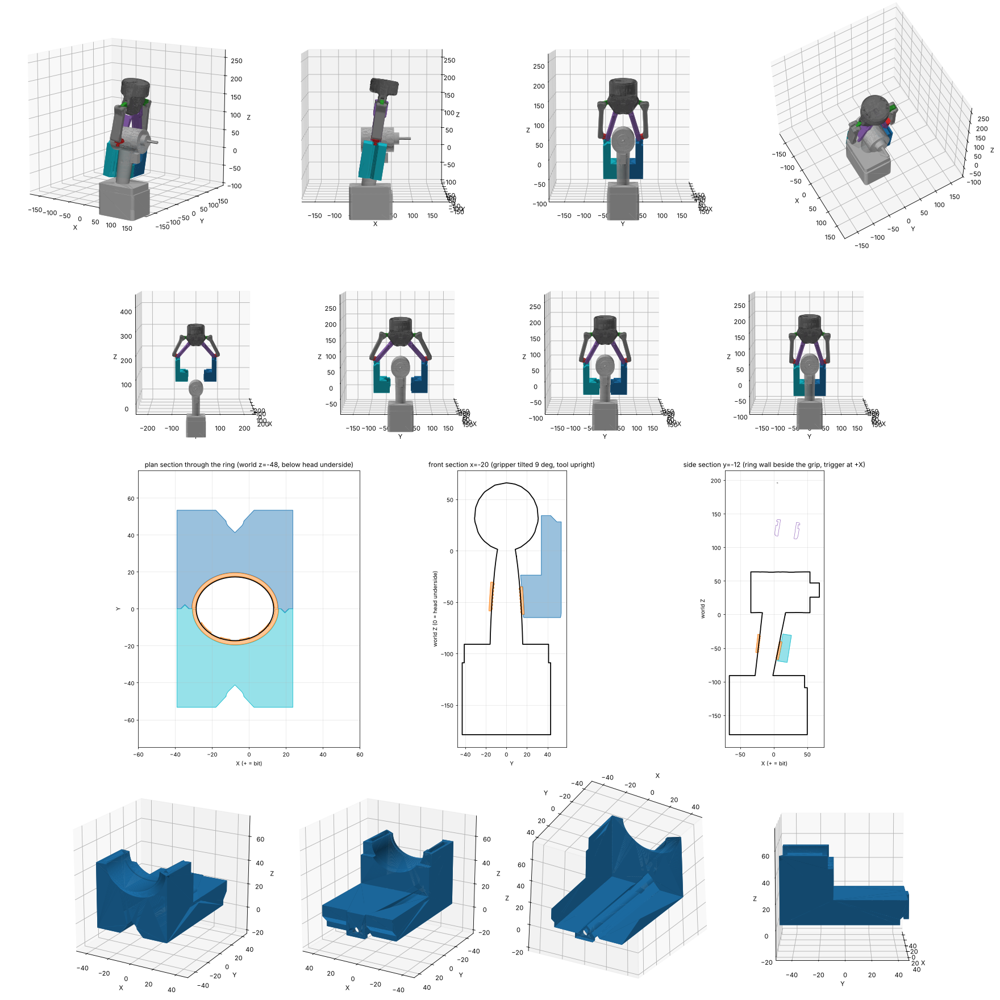
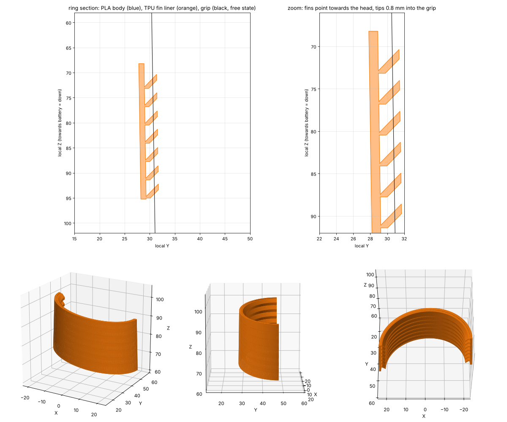

# Robotiq 2F-140 × Makita TD005G 环抱式夹爪

Robotiq 2F-140 自适应夹爪的自制指尖，用来从上往下抓**立着放的牧田 TD005G 冲击起子**。手指从机头两侧绕下去，越过扳机，合拢后在握把上形成一个**完整的环**，把握把箍住。
材料是 **PLA 本体 + TPU 方向性软鳍内衬**，用 **Bambu Lab H2D Pro** 双喷头一次打印成型。

## 状态
- [x] 运动学搜索、碰撞检查、有限元分析（PLA）
- [x] 试作件文件（S/M/L 三种尺寸）
- [x] 正式件 S/M/L 三种尺寸都已做好
- [ ] **在真起子上试装 → 选尺寸**
- [ ] 打印正式件，装到夹爪上抓取测试

## 流程：打试作件 → 选尺寸 → 打同尺寸的正式件

| 试作件刻痕 | 尺寸 | 正式件文件 |
|---|---|---|
| 1 道 | S（握把偏细，环小 0.6 mm） | `2_final/final_S_onepiece_H2DPro.3mf` |
| 2 道 | M（按设计尺寸） | `2_final/final_M_onepiece_H2DPro.3mf` |
| 3 道 | L（握把偏粗，环大 0.6 mm） | `2_final/final_L_onepiece_H2DPro.3mf` |

如果三个都不合适（S 还太松，或者 L 还太紧），把情况告诉 Claude，再加做更小或更大的尺寸。

## 怎么用（详细步骤见 [`docs/manual_H2DPro_zh.md`](docs/manual_H2DPro_zh.md)）
| 目录 | 内容 |
|---|---|
| [`1_trial/`](1_trial) | **试作件**：`trial1_PLA_rings_SML.3mf`（约 61 分钟）+ `trial2_TPU_liners_SML.3mf`（约 25 分钟）。拿到真握把上试，挑出最合适的尺寸 |
| [`2_final/`](2_final) | **正式件**：`final_S/M/L_onepiece_H2DPro.3mf`。**试作件哪个尺寸合适，就打同字母的文件**。一个文件打完两个夹爪，PLA 和 TPU 熔成一体，根部填充 100%。每个文件约 8 小时 44 分，PLA 约 254 g，TPU 约 12 g |
| [`3_separate_parts/`](3_separate_parts) | 分体 STL（S/M/L 各一套）：本体和内衬分开打，内衬再卡进去 |
| [`cad/`](cad) | STEP 文件和起子的近似模型 |
| [`docs/`](docs) | 操作手册、强度分析、设计说明 |
| [`scripts/`](scripts) | 运动学模型、姿态搜索、参数化 CAD、有限元、3MF 生成脚本 |

**喷头分配：PLA 用左喷头，TPU 95A HF 用右喷头**（Bambu 官方规定 H2D 的 TPU 只能用右喷头，从背面 TPU 口进料，不能走 AMS）。

## 设计要点
- **抓取姿态**：夹爪倾斜 9°（跟握把轴线平行），抓住时指尖螺丝轴离中心 S = 48 mm（θ = 0.413 rad）。机头的圆顶会顶进两根内连杆之间的 V 形空间，比指尖安装面高出约 30 mm。这样指尖长度控制在 100 mm 以内，环也能抱到机头底面往下 **33–64 mm** 的握把上，在扳机下面。
- **为什么不会掉**：
  1. 环把握把整圈封闭；椭圆截面在椭圆环里转不动。
  2. 握把上粗下细（约 2.4°），起子往下滑会楔死在环里。
  3. 2F-140 是自锁的，起子往外撑也推不开手指。
  4. TPU 鳍片朝机头方向斜，起子往下拉时鳍片会立起来顶住，像倒刺一样。
- **安装接口**：跟原厂指尖一样用 2 根 Ø2 定位销，螺丝改成 **M5×16**，加外径 12 mm 垫圈；底板厚 8 mm。拧紧力矩 0.8 N·m。
- **夹持力 25–35 N**：这时 PLA 的有限元结果是最坏工况约 3–5 MPa，长期蠕变安全系数约 3。详见 [`docs/`](docs)。
- **起子尺寸**：从官方侧面照片换算的（机头长 100 mm 定比例）。握把宽、机头宽是估计值，试作件就是用来确认这些尺寸的。

## 参考来源
- Robotiq 2F-140 三维模型：[robotiq/isaacsim_assets](https://github.com/robotiq/isaacsim_assets)；URDF 连杆参数：[ros-industrial/robotiq](https://github.com/ros-industrial/robotiq)
- Robotiq 2F-85/2F-140 说明书（指尖接口 M5×12、Ø2×6 定位销、指尖长度 ≤100 mm、自锁、外载限制）
- Bambu Lab Wiki：H2D TPU Printing Guide / AMS 2 Pro Setup / H2D USB 规格
- Bambu PLA Basic、TPU 95A HF 技术数据表
